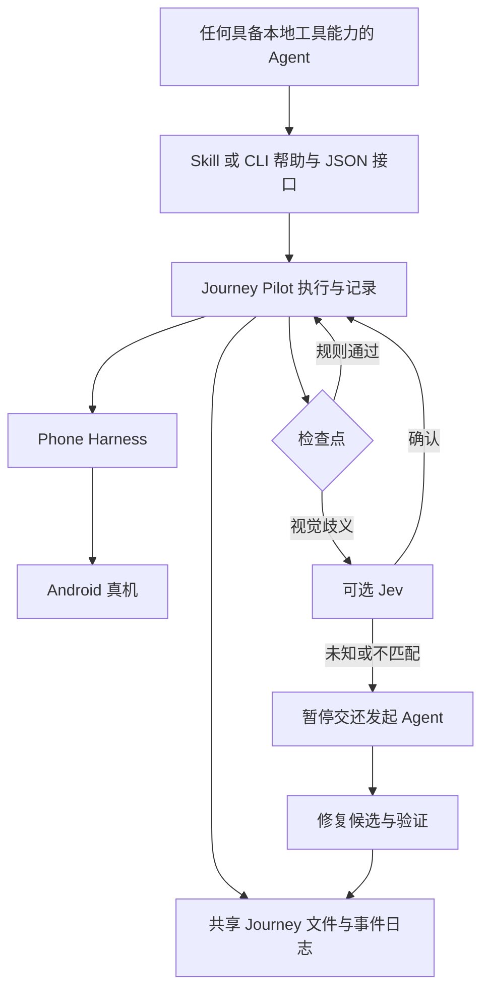

# 首版架构计划

状态：未开发；详规以 experience-rules.md 和 agent-interface.md 为准。

逻辑模块：CLI 契约、设备适配器、事件记录器、文件存储/目录、候选验证器、Journey 执行器、规则检查器、可选视觉检查器。单个本地进程执行一段 Journey，不需要 Agent 在中间逐步调用。

源代码维护在项目中；运行数据默认 ~/.local/share/journey-pilot，可由 JOURNEY_PILOT_HOME 指定。同用户不同 Agent 和 cwd 共享同一经验；不同设备执行隔离，同设备串行。

探索与重放共用记录入口。事实日志自动写入；候选提炼由 Agent 完成；验证晋级由工具检查。任何绕过入口的操作不承诺可观察或已记录。

首版先保存页面观察与转换证据，不建设图搜索、通用地图 UI 或自动路线组合。Kimi/Web 接入和 app-automating 存储复用为后续评估项。
